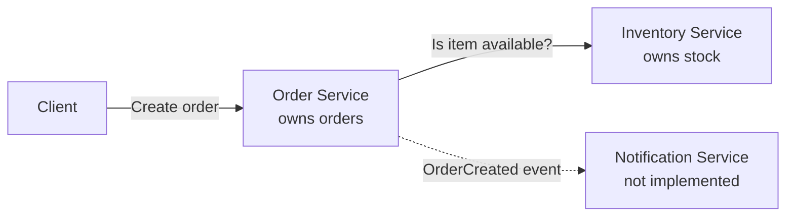

# CMPE 273 - Module 4: Architecture & Service Boundaries

A small online store split into services. The Order Service checks availability with the Inventory Service over HTTP before it creates an order. Both run as separate Python (Flask) processes with in-memory data.

## Setup

```bash
python3 -m venv .venv
source .venv/bin/activate
pip install -r requirements.txt
```

## Running the services

Each service runs in its own terminal.

```bash
python services/inventory_service.py
```

```bash
python services/order_service.py
```

Inventory runs on port 5051 and Order runs on port 5050. Place an order:

```bash
curl -X POST localhost:5050/orders -H 'Content-Type: application/json' -d '{"item_id": "keyboard", "quantity": 2}'
```

To run every test case in one go (starts both services, stops and restarts Inventory, prints the logs):

```bash
./scripts/demo.sh
```

The full output from my run is in [evidence/demo_output.txt](evidence/demo_output.txt).

## Architecture



The Order → Inventory call is synchronous because the order can't be confirmed without the answer. Notification is shown with a dotted line because it would listen for an `OrderCreated` event (for example through a message queue) instead of being called directly. I didn't implement it since the assignment only requires the Order → Inventory interaction.

| Component | Responsibility | Data it owns |
|---|---|---|
| Order Service | Accepts order requests, validates input, asks Inventory about availability, creates the order as CONFIRMED or REJECTED, and lets clients look up an order by id | Orders: `order_id`, `item_id`, `quantity`, `status`, `created_at` |
| Inventory Service | Knows how many units of each item are in stock and answers availability checks | Stock levels per item (`item_id` → quantity) |
| Notification Service | Tells the user when an order is created (email, SMS, etc.) | Notification records and delivery status, user contact preferences |

## Why these service boundaries

I split the services by business capability, so each one has one job and is the only one that reads or writes its data. Order never touches the stock table directly. It has to ask Inventory, so if the way stock is stored changes later, Order doesn't need to change as long as the API stays the same.

Inventory changes for different reasons than orders do (restocks, warehouse updates), and it gets a lot more read traffic since every order and every product page would check it. Keeping it separate means it can be scaled and deployed on its own.

Notification is separate because it's a side effect of an order, not part of creating one. If emails are slow or the notification provider is down, orders should still go through. Making it an event consumer keeps it out of the order request path.

## Command, Query, and Event

| Interaction | Type | Why |
|---|---|---|
| Check whether an item is available | **Query** | It only reads the current stock and returns an answer. Nothing changes, so it's safe to retry. In my code it's a `GET`. |
| Create an order | **Command** | It's a request to change state (a new order gets created) and it can be rejected, for example if the item is out of stock. It's a `POST`. |
| Order was created | **Event** | It's a fact about something that already happened, named in the past tense. Order Service would publish it without knowing or waiting on who listens, like Notification. |

## Inventory data

```python
STOCK = {
    "keyboard": 12,
    "monitor": 4,
    "mouse": 0,
}
```

## Successful request

Order for an item that's in stock:

```
$ curl -s -X POST localhost:5050/orders -H 'Content-Type: application/json' -d '{"item_id": "keyboard", "quantity": 2}'
{"created_at":"2026-10-24T19:25:05+00:00","item_id":"keyboard","order_id":"900b7db2-93ba-4c3d-9015-c1bd5e465a49","quantity":2,"status":"CONFIRMED"}
HTTP 201
```

Order for an item that's out of stock (Inventory says unavailable):

```
$ curl -s -X POST localhost:5050/orders -H 'Content-Type: application/json' -d '{"item_id": "mouse", "quantity": 1}'
{"created_at":"2026-10-24T19:25:05+00:00","item_id":"mouse","order_id":"ba217c71-215e-4733-ba0c-50b422fb5cb3","quantity":1,"reason":"'mouse' is unavailable","status":"REJECTED"}
HTTP 409
```

## Failure test: Inventory Service stopped

I stopped the Inventory Service and submitted another order. Order Service catches the connection error, returns 503, and doesn't create the order:

```
$ kill 57339

$ curl -s -X POST localhost:5050/orders -H 'Content-Type: application/json' -d '{"item_id": "monitor", "quantity": 1}'
{"error":"inventory service is unavailable, order was not created"}
HTTP 503
```

Order Service log:

```
[order] inventory unreachable at http://localhost:5051, order for monitor not created
[order] 127.0.0.1 - - [24/Oct/2026 12:25:05] "POST /orders HTTP/1.1" 503 -
```

The Order Service process is still up, and its own data is still readable because it doesn't depend on Inventory:

```
$ ps -p 57334 -o pid,command
  PID COMMAND
57334 .../Python services/order_service.py

$ curl -s localhost:5050/health
{"status":"ok"}
HTTP 200

$ curl -s localhost:5050/orders/900b7db2-93ba-4c3d-9015-c1bd5e465a49
{"created_at":"2026-10-24T19:25:05+00:00","item_id":"keyboard","order_id":"900b7db2-93ba-4c3d-9015-c1bd5e465a49","quantity":2,"status":"CONFIRMED"}
HTTP 200
```

After restarting Inventory, the same Order Service process (no restart) accepts the order:

```
$ curl -s -X POST localhost:5050/orders -H 'Content-Type: application/json' -d '{"item_id": "monitor", "quantity": 1}'
{"created_at":"2026-10-24T19:25:05+00:00","item_id":"monitor","order_id":"61391b95-f72a-49c2-ac55-23475665cd04","quantity":1,"status":"CONFIRMED"}
HTTP 201
```

The call also has a 2 second timeout (`INVENTORY_TIMEOUT_SECONDS`), so if Inventory hangs instead of going down, Order returns 504 instead of waiting forever.

## Reflection

Clear service boundaries mean each service has one job, so a team can change, deploy, or scale it without breaking the others. Data ownership goes with that. If only Inventory can read and write stock, there's one source of truth, and other services have to go through its API instead of reaching into its data and depending on how it's stored. When services share data or have blurry responsibilities, a change in one place quietly breaks another, and that's much harder to debug once there's a network between them. In this assignment, because Order owns its own data, it could still serve existing orders and fail new ones cleanly when Inventory was down.
